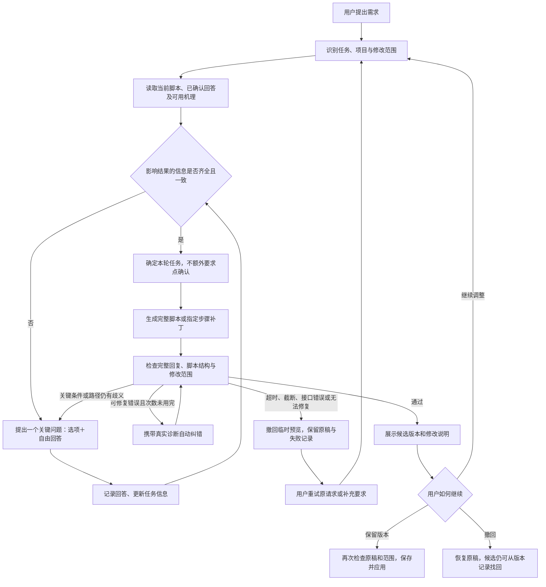

# Chemiation AI 脚本生成与完善标准流程 V1

制定日期：2026 年 10 月 25 日。

本文确定产品流程、提问规则、生成边界与验收方式。同日后续已在原项目实现任务识别、明显缺项补问、回答记录、仅解释、修改约束和中断重试等核心逻辑，详见 [实现记录](ai-workflow-implementation-20261025.md)。文中标为“应”的内容仍包含目标要求，复杂化学语义和专业审核不能视作已全部实现；经确认的紧凑界面也已应用至原项目，详见 [界面与体验说明](ai-compact-layout-20261025.md)。

## 1. 用户应该得到的体验

用户只需说清楚想展示或修改什么。系统先读取已有信息；缺少影响结果的关键信息时，用“一个问题＋具体选项＋自由回答”引导补充；信息足够后自动开始生成、检查和动画预览。用户不用每次在提示词里写“请先问我”。

**固定处理顺序，按需提问，不要求用户每次填写整份表单。**

主流程：识别任务 → 读取已有信息与适用机理 → 判断信息是否足够 → 按需追问 → 确定本轮任务 → 生成或修改脚本 → 自动检查与有限纠错 → 动画预览 → 用户保留版本。

生成期间可并行显示进度：完整、可解析且通过当前基础检查的步骤才进入左侧临时预览。它们不代表整份脚本已经检查通过；最终仍执行完整检查和“保留版本”。

## 2. 先分清用户要做什么

| 任务 | 系统先读取 | 需要补问的情况 | 输出要求 |
| --- | --- | --- | --- |
| 生成新机理 | 当前请求、本对话已确认信息、用户明确引用的机理 | 反应对象不清楚，或缺少会影响路径的条件 | 完整、可播放的 CCPL 或当前项目已支持的脚本格式 |
| 完善整份脚本 | 当前脚本或正在预览的候选、原稿基准、修改目标 | “优化一下”无法确定是改说明、结构还是展示；要求相互冲突 | 完整候选版本，说明主要改动 |
| 只完善指定步骤 | 锁定的步骤编号、完整源脚本、原稿基准、修改要求 | 未选定步骤；原稿真正变化；需求必须涉及其他步骤 | 仅返回选中步骤的补丁，由程序合并并检查整份脚本 |
| 修复脚本错误 | 原脚本、解析器诊断、已确认反应意图 | 修复需要决定未知反应物、产物或路径 | 在保持原意的前提下修复；无法判断的部分先提问 |
| 仅解释机理 | 当前步骤或用户指定的内容 | 指代对象不明，或解释依赖尚未确定的条件 | 直接解释，不强制生成脚本或追加问题 |

任务不明确时，只问一次能区分操作的问题，例如“这次主要想完善说明，还是调整结构？”不要反复询问用户已经明确说出的任务。

用户要求“改当前步骤”但没有有效范围时，应先确定步骤。不能只依赖模型记住“其他步骤不变”，也不能自动退回整份修改。

## 3. 什么信息必须问，什么可以沿用

### 3.1 生成新机理的最低条件

满足以下条件才进入脚本生成：

1. **知道要表达什么反应。** 反应名称、明确结构、反应方程式、用户选定的完整示例等，能足够明确地确定对象；不要求用户同时提供所有表达方式。
2. **知道预期变化。** 产物、成键断键目标或已明确的反应类型足以确定展示任务；不能确定时再问，不把“未知产物”一律当作缺项。
3. **不存在未解决的关键路径分歧。** 仅当底物身份、催化方式、介质、立体要求等缺失会影响本次结果时，才追问对应项。不是每个反应都必须填写溶剂、温度和催化剂。
4. **能用当前引擎诚实表达。** 不为动画效果虚构稳定中间体，不把展示插值当作真实反应轨迹；无法表达的科学细节应说明边界。

“生成一个酯化反应”可能需要先确定具体底物；“按当前这份完整脚本生成教学讲解”则不应重新询问已经包含的信息。

### 3.2 完善已有脚本的最低条件

必须知道：**修改哪份源稿、改哪里、达到什么目标、哪些内容不能动。**

- 只改说明：已有源稿和步骤明确即可开始，不因用户没写溶剂或温度而阻塞。
- 调整布局或展示：先明确用户所指的视觉问题，复用现有布局与播放能力；不写解析器不支持的指令。
- 改结构或路径：重新核对本次变化涉及的化学信息和其他步骤的关联。
- 修改会破坏未选步骤的守恒关系：说明涉及哪些步骤，给出“保留结构、只改说明”或“重新选择相关步骤”等可行方向，等待用户选择；不得自行扩大范围。

### 3.3 可以采用的产品默认值

以下偏好未提供时，可直接采用默认值，不强制追问：

| 项目 | 默认行为 |
| --- | --- |
| 语言 | 跟随用户和当前项目语言 |
| 讲解深度 | 面向本科基础教学，说明简洁 |
| 展示风格 | 沿用当前项目配色、布局和播放习惯 |
| 展示状态数量 | 按表达需要安排，不固定凑成三步或五步 |
| 输出格式 | 沿用源稿已支持的格式；新建采用当前项目的 CCPL |
| 是否自动检查 | 默认开启，无需再问 |
| 是否流式展示 | 默认开启，接口不支持时显示真实等待状态 |

**反应物、会改变路径的条件、产物分支、立体结果以及修改范围，没有通用的隐含默认值。** 需要假设条件的教学示例，应明确列出假设并让用户选择采用；不能把“你看着办”解释为所有化学条件都已确认。

## 4. 提问采用统一规则

### 4.1 提问顺序

优先解决会阻止执行的问题：

1. 任务对象和修改范围不明。
2. 反应物或目标变化不明。
3. 会影响路径的关键条件缺失。
4. 用户要求、当前脚本或已回答条件互相矛盾。
5. 展示偏好确实影响本次结果且无法采用默认值。

这是优先级，不是固定问卷。已经明确的项直接跳过。涉及决定性矛盾时，应先解决矛盾，再继续后续问题。

### 4.2 每轮提问的样式

- 每次提出一个主要问题，可用一句短说明解释它为何影响结果。
- 能列出合理选项时提供 2—4 个，选项要具体、容易区分，不能夹带未经确认的条件。
- 自由回答始终可用；无法合理列出选项时只显示自由回答。
- 不预选答案、不自动提交，保留“直接发消息”入口。
- 用户可以不知道答案。必要时可给“采用已说明假设的教学示例”这条可选路径，但不能默认代选。
- 避免用“其他”代替实际选项；自由输入本身已覆盖补充需求。

示例：

> 你想展示哪一组反应物？
>
> A. 乙酸与乙醇
>
> B. 乙酸与甲醇
>
> 自由回答：也可以输入另一组反应物的名称或结构。

此时不连带替用户确定催化剂、介质或具体实验参数。选项只回答当前问题。

### 4.3 回答后如何推进

系统先更新本轮任务，再检查是否仍有关键缺项：缺项就问下一题，足够就开始生成。不要回答一题后又从第一题重来，也不要为了流程完整强行再问“是否开始”。

选项和自由回答都要读取。自由回答明确修正了选项时，按用户的明确修正更新；存在无法判断的冲突时，只澄清冲突部分，不把矛盾条件一起发给生成器。

用户中途修改条件，应更新受影响的任务项，并使依赖旧条件的计划或候选失效。无关的已确认信息继续保留。

普通教学创作应争取在 1—3 轮关键追问内进入生成，这只是体验目标，不是填满轮数的要求。超过三轮仍缺决定性信息时，明确列出尚缺内容，并提供采用明确教学示例或暂存任务的路径；不能因为达到轮数就开始猜，也不要反复换措辞问同一个问题。

## 5. 让对话信息形成一份可恢复的任务记录

每轮任务至少应记录以下内容，而不只依靠长聊天全文：

| 内容 | 用途 |
| --- | --- |
| 所属账号、机理项目和对话 | 保证隔离与恢复位置正确 |
| 任务类型及用户原话 | 记录本轮真实目标 |
| 源稿、基准版本、指定步骤 | 保证生成和写入都遵守范围 |
| 已明确的反应对象、目标和必要条件 | 避免长对话中丢失关键要求 |
| 必须保持不变的内容 | 约束修复和后续修改 |
| 每项信息的来源与状态 | 区分用户确认、脚本继承、模板参考和未知 |
| 当前待回答的问题、表单草稿 | 刷新或切换后接着回答 |
| 当前阶段、失败原因、重试依据 | 不重复开新任务，也不丢失旧请求 |

信息来源不能混为一谈：

- 用户最新的明确修改，应更新之前的用户要求。
- 当前脚本可以提供待编辑的结构，但脚本内容本身不等于经过专业审核。
- 本对话中用户已经确认的信息可以沿用；助手先前的推测不能升级为已确认条件。
- 其他对话的脚本仅通过用户可见的检索与引用复用，不自动合并其他聊天正文。
- 没有记录的条件保持未知，不用模型生成的摘要补成“用户已经说过”。

这份记录是程序的任务数据，不要求新增一个独立智能体，也不要求每轮额外调用一次模型。可在后续实现中作为现有会话的可选字段保存，兼容旧记录；本轮不改数据库。

## 6. 已有机理怎样参与流程

1. 对象明确后检索用户可访问的机理，避免每回答一题都重复全库搜索。
2. 名称或关键词相近，只表示找到参考项，不证明底物、条件和路径一致。
3. 用户选定参考机理后，先提取适用信息，补问剩余缺项；不重新询问已确认内容。
4. 只有反应对象、必要条件与任务目标一致，且有可信的来源或审核信息时，才可以将其作为明确依据；未知字段不能当成匹配成功。
5. 即使复用已有脚本，也要重新做当前版本的基础检查，并进入候选预览。原稿仍需用户点击“保留此版本”才改变。

当前代码主要按名称和关键词匹配，尚不能证明条件一致。本标准的第一阶段应保留参考选择与追问，不把现有匹配分数当成化学可靠性分数。

## 7. 信息足够后，按什么标准生成

进入生成前，系统应已形成一份明确的本轮要求：任务类型、反应对象、必要条件、展示目标、源稿与修改范围、不能改变的内容。

可以在聊天里用一句话概括，例如：“本轮仅完善第 2 步说明，保留结构及其他步骤。”信息明确时直接执行，不再增加确认弹窗。

### 7.1 新生成

- 输出完整、适配当前解析器版本的脚本。
- 展示状态围绕需要讲清楚的变化组织，区分反应初态、真实中间体、示意状态与产物；不为固定步骤数虚构路径。
- 各状态中保留需要表达的原子、离去基团和相关物种，保持身份与守恒关系，不为凑校验擅自补入未知原子、离子或旁路反应。
- 机理说明、结构和用户已经确定的条件保持一致。
- 空间安排优先使用已有布局能力，不要求模型逐个猜测所有坐标。

### 7.2 完善已有脚本

- 整份修改仅改变本轮目标涉及的内容，不顺手改名、改反应或改格式。
- 指定步骤只输出选中的步骤补丁，由程序合并源稿；未选内容逐字保留。
- 只改文字时，原子、键、电荷、步骤数量和顺序不变。
- 用户从预览继续修改时，以其选定的候选为修改源，同时保留工作区原稿作为写入前冲突基准。
- 源稿内容真正变化时暂停旧任务，要求重新选定；纯注释和空白整理只能在现有保守重绑定条件下处理。

## 8. 检查、自动纠错和失败处理

按以下顺序检查，前一层失败不能宣称后一层通过：

| 层次 | 检查重点 | 失败后的处理 |
| --- | --- | --- |
| 接收完整性 | 正常结束标记、截断、空回复、超时、取消 | 保留片段并撤回临时预览；不拿截断内容自动续成正式结果 |
| 可执行性 | CCPL/JSON 格式、支持的语法、原子引用、坐标等 | 在保持已确定意图的前提下，携带真实诊断修复 |
| 当前基础结构规则 | 编号、重复键、当前支持的键级与价键规则、跨步骤元素和电荷等 | 能按已明确要求修复时有限纠错；涉及未知条件时回到提问 |
| 修改约束 | 是否只改指定步骤；只改说明时结构是否保持 | 拒绝越界结果并按原范围修复，不扩大范围 |
| 需求覆盖 | 是否完成本轮目标，有无遗漏用户已确认条件 | 可明确修正的遗漏进行修正；需要用户决定的分支先问 |
| 科学审核状态 | 依据、假设及尚未核实的机理细节 | 如实标明待核对；程序基础检查不能替代专业审核 |

自动纠错沿用现有上限：每次任务最多追加两次修复请求，共用本次任务的总超时预算。第一版不增加一个无上限的“反复检查直到成功”循环。

认证失败、限流、断网、服务异常、超时或截断，不进入脚本自动纠错；应显示真实原因，保留任务与片段，由用户处理后重试。修复次数用完、重复同样错误或发现原稿冲突时停止，不覆盖原稿。

纠错不能代替用户决定反应条件，不能为了通过程序检查改变反应意图或删除无法处理的步骤。

## 9. 左侧动画、版本与界面规则

- 用户回答问题时，左侧保留当前机理或上一个有效候选，不闪成空白。
- 生成期间，只预览完整且通过当前基础检查的步骤；不执行半截原子、半截化学键或未闭合脚本。
- 指定步骤预览应先合并完整源稿，其他步骤不被替换。
- 后续步骤出错、停止、超时、切换项目或原稿冲突时撤回临时预览。
- 全部检查结束后，显示候选结果、修改要点和必要的待核对说明，允许对比、继续修改、保留或撤回。
- “保留此版本”前再次检查源稿和范围，先完成本机保存及原稿保护，再应用。云端同步状态单独如实显示。
- 每次保留记录源版本、目标步骤、用户请求与检查结果；恢复旧版本时留下新的恢复记录。
- 沿用左侧动画、右侧原工作区，以及现有问题卡片和历史面板。流程阶段用短状态文字表达，不新增第三侧栏、不堆叠多个表单或每阶段弹窗。

建议用户可见的阶段文字：**补充信息 → 正在生成 → 自动检查／纠错 → 可预览 → 已保留**。仅在确实进入某阶段时显示，不伪造进度百分比或“零延迟”。

## 10. 标准验收案例

以下案例用于下一阶段实现验收；本轮没有据此运行模型测试。

| 输入或操作 | 应有结果 |
| --- | --- |
| “帮我生成一个酯化反应。” | 先确定具体反应对象，不直接替用户选定所有条件 |
| 给出足够明确的反应、必要条件和展示要求 | 直接生成，不强制问一遍教学偏好或“是否开始” |
| 选择已有步骤：“只把说明写得更适合本科生。” | 直接修改说明，不重新追问无关实验条件；结构与其他步骤不变 |
| “优化一下”，无法判断用户指说明还是结构 | 先问一个区分目标的问题 |
| 只允许改第 2 步，但要求会影响其他步骤的结构变化 | 指出关联和可行方向，不偷偷修改其他步骤 |
| 一个问题同时选择选项并输入相反的自由回答 | 识别明确修正或澄清矛盾，不拼接互斥条件生成 |
| 连续回答后刷新页面 | 恢复本轮任务、指定范围、待答问题和未提交表单 |
| 对话很长，早期已明确某项必要条件 | 从确认记录恢复，不重复问，不让后续推测替换该条件 |
| 命中同名但条件未知的历史机理 | 展示参考与适用条件提示，不自动认定为当前任务正确答案 |
| 生成一半出现截断或网络错误 | 撤回临时预览，原稿保留；重试仍使用原请求、条件和范围 |
| 基础校验报错 | 传递真实诊断，最多两次自动修复；不能把未通过结果直接应用 |
| 用户中途更改会影响路径的条件 | 更新任务，撤销依赖旧条件的候选；无关已确认信息继续保留 |
| 用户只问“为什么这一步会这样变化？” | 回答解释，不强制编写新脚本或连续追加表单 |
| 用户点击保留、恢复或切换对话 | 保留和恢复有版本记录；单纯切换对话不覆盖项目脚本 |

## 11. 与现有项目的衔接及实施顺序

现有本地版已经具备：问题选项与自由回答、范围和表单草稿保存、流式完整步骤预览、部分基础检查、有界纠错、失败重试、候选保留和版本历史。

下一阶段应优先补齐：

1. **统一任务识别与信息检查。** 把不同入口放入同一套规则，生成前判断是否缺少决定性信息；不只依赖模型临时决定是否追问。
2. **保存已确认条件和待办项。** 将问题回答关联到具体任务项，让刷新、重试和长对话都能恢复；明确区分继承、确认和推测。
3. **区分生成、修改、修错和解释。** 让仅解释的问题直接得到解释，让指定步骤修改保持程序级边界。
4. **补上需求覆盖检查与结果说明。** 基础结构校验之外，再核对本轮要求是否满足；不能验证的科学内容明确待审核。
5. **执行上述固定场景验收。** 同时保留真实模型与模拟接口的测试记录，分开记录脚本可执行性、需求完成度和专业审核结果。

先在原控制器、现有请求管线和会话文档中增加必要规则与可选状态字段，不把本规范直接升级为新的多智能体架构、向量数据库或整套界面重做。若实施时发现必须引入独立规划服务、额外固定模型调用或新的科学计算引擎，应先说明影响和范围。

当前对应代码：`js/aiStudio.js`、`js/aiAssistant.js`、`js/aiStudioCore.js`、`js/aiEditingTools.js`、`js/aiTaskSafety.js`。既有存储与接口说明见 [对话工作台说明](ai-studio.md)、[本轮四项细节优化](ai-chat-improvements-20261025.md)。
